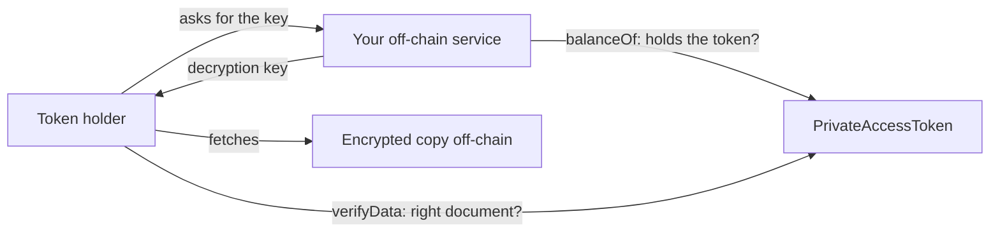

<p align="center">
  
</p>

<p align="center">
  
<a href="https://github.com/CoinClubQuincy/PrivateAccessToken/actions/workflows/build.yml"></a>        
</p>

<p align="center">
  <a href="#how-it-works">How it works</a> · <a href="#try-it">Try it</a> · <a href="#what-is-tested">What is tested</a> · <a href="#known-issues">Known issues</a>
</p>

This demo shows how a token can control access to private data without putting that data on-chain. The contract stores only a hash of the data and a link to an encrypted copy kept elsewhere. Sell or transfer the token, and the right to access moves with it.

> [!CAUTION]
> **Gating a function does not hide anything.** `private` in Solidity only stops other contracts from reading a variable, and anyone can read the hash and the link from chain state. A test in this repo does that. Privacy depends on the encryption and on your off-chain service, which must check the token before handing over the decryption key. This contract has not been audited.

## How it works




| Function | What it does |
| --- | --- |
| `constructor(dataHash, encryptedDataURI, uri)` | Stores the hash and link, and mints the access token to the deployer |
| `ViewData()` | Returns the hash and link to the token holder |
| `verifyData(hash)` | Tells anyone whether a hash matches the stored one |
| `ViewStatus()` | Returns the caller's token balance |

Add a random salt to what you hash. A hash of predictable data can be guessed.

The off-chain service and the encryption are not part of this repo. You need to build them.

## Try it

```bash
git clone https://github.com/CoinClubQuincy/PrivateAccessToken.git
cd PrivateAccessToken
git clone --depth 1 -b v4.9.6 https://github.com/OpenZeppelin/openzeppelin-contracts lib/openzeppelin-contracts
git clone --depth 1 -b v1.9.7 https://github.com/foundry-rs/forge-std lib/forge-std
forge test
```

You need [Foundry](https://getfoundry.sh).

## What is tested

[`test/foundry/PrivateAccessToken.t.sol`](test/foundry/PrivateAccessToken.t.sol) has 7 tests and runs in CI on every push. They show holders can call `ViewData`, others are refused, access moves with the token, anyone can verify a hash, and the stored hash can be read from storage without the token. It has not been run on a real network or audited.

## Changes from earlier versions

Contracts already deployed are unaffected. **Anything an earlier deployment stored can still be read from the chain, and it cannot be removed.**

- The constructor takes a data hash and an encrypted data link instead of the data itself.
- `ViewData` returns those two values.
- `verifyData` is new.
- The older Truffle test was removed. Foundry is the supported test path.

## Known issues

| Issue | Effect | Test |
| --- | --- | --- |
| The hash and link are public | Anyone can read them without the token, so the link must only ever point to encrypted data | `test_TheStoredHashIsReadableWithoutTheToken` |
| Selling the token does not revoke a key | A past holder who already has the decryption key can still read the data. Encrypt again with a new key if that matters | Read from the code |

<details>
<summary><strong>More XDC projects</strong></summary>

| Group | Project | What it is |
| --- | --- | --- |
| Standards | [XRC-SHARES](https://github.com/CoinClubQuincy/XRC-SHARES) | Dividend-paying NFT shares and SPLITS for a DApp |
| Standards | [XRCDividendPlus](https://github.com/CoinClubQuincy/XRCDividendPlus) | Dividend-paying XRC-20 token |
| Treasury and finance | [Multi-Sig-Treasury](https://github.com/CoinClubQuincy/Multi-Sig-Treasury) | Treasury controlled by tokenized keys |
| Treasury and finance | [XRC-Airdrop](https://github.com/CoinClubQuincy/XRC-Airdrop) | Self-run token airdrop |
| Treasury and finance | [XRC-Credit](https://github.com/CoinClubQuincy/XRC-Credit) | Debt contract skeleton |
| Treasury and finance | [XDC-Defi-Instruments](https://github.com/CoinClubQuincy/XDC-Defi-Instruments) | Assets, agreements, forwards, futures and a marketplace |
| Identity and access | [LoginMFAContract](https://github.com/CoinClubQuincy/LoginMFAContract) | Login with a password and an NFT |
| Identity and access | [Delegated_Authority](https://github.com/CoinClubQuincy/Delegated_Authority) | KYC notary proof of concept |
| Learning and libraries | [XDC-LemonadeStand](https://github.com/CoinClubQuincy/XDC-LemonadeStand) | Workshop DApp built on XRC-SHARES |
| Learning and libraries | [Non-Financial-SmartContracts](https://github.com/CoinClubQuincy/Non-Financial-SmartContracts) | Games, inventory, keys and on-chain repositories |
| Tools | [XDC_Python_SDK_V1](https://github.com/CoinClubQuincy/XDC_Python_SDK_V1) | Python client for the XDC JSON-RPC API |
| Tools | [PrivateXDCNode_SetupScript](https://github.com/CoinClubQuincy/PrivateXDCNode_SetupScript) | Private XDC network setup scripts |
| Tools | [WebApp_to_XDCPay](https://github.com/CoinClubQuincy/WebApp_to_XDCPay) | Web app to XDCPay tutorial |
| Multi-chain | [CoinClub_Framework](https://github.com/CoinClubQuincy/CoinClub_Framework) | Python library with an XDC adapter |
| Interfaces | [Contract_Interface_Model_Language](https://github.com/CoinClubQuincy/Contract_Interface_Model_Language) | Interface documents for smart contracts and APIs |

</details>

## License

[MIT](LICENSE).
