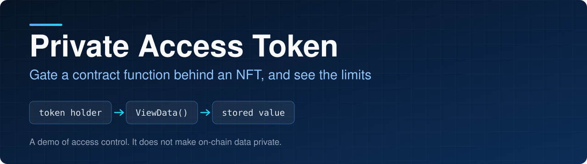
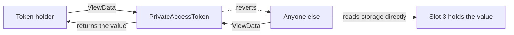

<p align="center">
  
</p>

<p align="center">
  
<a href="https://github.com/CoinClubQuincy/PrivateAccessToken/actions/workflows/build.yml"></a>        
</p>

<p align="center">
  <a href="#how-it-works">How it works</a> · <a href="#try-it">Try it</a> · <a href="#what-is-tested">What is tested</a> · <a href="#known-issues">Known issues</a>
</p>

This demo stores a value in a contract and only lets the holder of an access token call the function that returns it. Sell or transfer the token, and the ability to call that function moves with it.

> [!CAUTION]
> **This does not keep data private. Never store real personal data this way.** `private` in Solidity only stops other contracts from reading a variable. Anyone can read the value from chain state or from the deployment transaction, and a test in this repo does exactly that. The earlier description here suggested otherwise, and that was wrong.

## How it works




| Function | What it does |
| --- | --- |
| `constructor(data, uri)` | Stores the value and mints the access token to the deployer |
| `ViewData()` | Returns the value to the token holder |
| `ViewStatus()` | Returns the caller's token balance |

**What it's good for:** learning how a token can gate a function. To protect real data, keep it off-chain, encrypted, and have the token control access to the decryption key or service.

## Try it

```bash
git clone https://github.com/CoinClubQuincy/PrivateAccessToken.git
cd PrivateAccessToken
git clone --depth 1 -b v4.9.6 https://github.com/OpenZeppelin/openzeppelin-contracts lib/openzeppelin-contracts
git clone --depth 1 -b v1.9.7 https://github.com/foundry-rs/forge-std lib/forge-std
forge test
```

You need [Foundry](https://getfoundry.sh). Tests named `test_KnownIssue_*` pass because they pin a defect, so a passing run does not mean the defect is gone.

## What is tested

[`test/foundry/PrivateAccessToken.t.sol`](test/foundry/PrivateAccessToken.t.sol) has 4 tests and runs in CI on every push. They show holders can call `ViewData`, others are refused, access moves with the token, and the value can be read from storage without the token. It has not been run on a real network or audited, and the older Truffle test was not run.

## Known issues

| Issue | Effect | Test |
| --- | --- | --- |
| The stored value is public | Anyone can read it without the token | `test_DataIsReadableFromStorageWithoutTheToken` |

<details>
<summary><strong>More XDC projects</strong></summary>

| Group | Project | What it is |
| --- | --- | --- |
| Standards | [XRC-SHARES](https://github.com/CoinClubQuincy/XRC-SHARES) | Dividend-paying NFT shares and SPLITS for a DApp |
| Standards | [XRCDividendPlus](https://github.com/CoinClubQuincy/XRCDividendPlus) | Dividend-paying XRC-20 token |
| Treasury and finance | [Multi-Sig-Treasury](https://github.com/CoinClubQuincy/Multi-Sig-Treasury) | Treasury controlled by tokenized keys |
| Treasury and finance | [XRC-Airdrop](https://github.com/CoinClubQuincy/XRC-Airdrop) | Self-run token airdrop |
| Treasury and finance | [XRC-Credit](https://github.com/CoinClubQuincy/XRC-Credit) | Debt contract skeleton |
| Treasury and finance | [XDC-Defi-Instruments](https://github.com/CoinClubQuincy/XDC-Defi-Instruments) | Assets, agreements, forwards, futures and a marketplace |
| Identity and access | [LoginMFAContract](https://github.com/CoinClubQuincy/LoginMFAContract) | Login with a password and an NFT |
| Identity and access | [Delegated_Authority](https://github.com/CoinClubQuincy/Delegated_Authority) | KYC notary proof of concept |
| Learning and libraries | [XDC-LemonadeStand](https://github.com/CoinClubQuincy/XDC-LemonadeStand) | Workshop DApp built on XRC-SHARES |
| Learning and libraries | [Non-Financial-SmartContracts](https://github.com/CoinClubQuincy/Non-Financial-SmartContracts) | Games, inventory, keys and on-chain repositories |
| Tools | [XDC_Python_SDK_V1](https://github.com/CoinClubQuincy/XDC_Python_SDK_V1) | Python client for the XDC JSON-RPC API |
| Tools | [PrivateXDCNode_SetupScript](https://github.com/CoinClubQuincy/PrivateXDCNode_SetupScript) | Private XDC network setup scripts |
| Tools | [WebApp_to_XDCPay](https://github.com/CoinClubQuincy/WebApp_to_XDCPay) | Web app to XDCPay tutorial |
| Multi-chain | [CoinClub_Framework](https://github.com/CoinClubQuincy/CoinClub_Framework) | Python library with an XDC adapter |
| Interfaces | [Contract_Interface_Model_Language](https://github.com/CoinClubQuincy/Contract_Interface_Model_Language) | Interface documents for smart contracts and APIs |

</details>

## License

[MIT](LICENSE).
